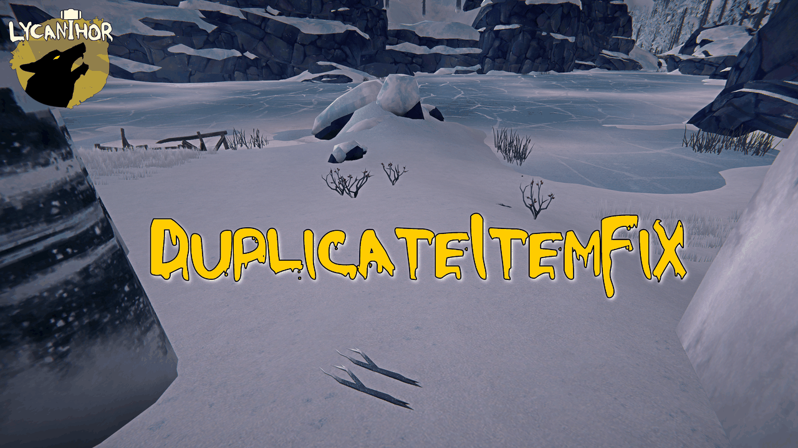

# DuplicateItemFix

Fixes sticks, stones, coal and other items in *The Long Dark* that you can pick up again and again from the same spot.

⚠️ Back up your saves first! 

It cleans up the bad data in your save as each region loads. You won't see anything happen, you just stop finding the same item twice. No settings.

More detail is in [DETAILS.md](DETAILS.md).

Requires: MelonLoader 0.7.2.
